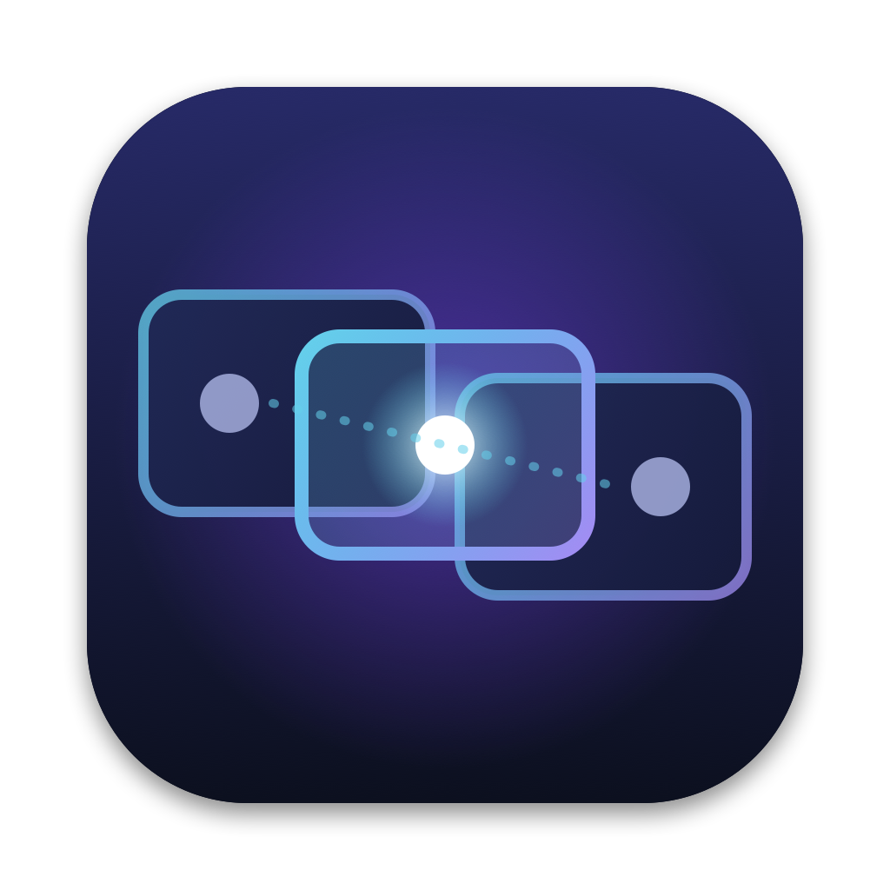

<p align="center">
  
</p>

<h1 align="center">MacFrameGen</h1>

<p align="center">
  Real-time frame generation for capture cards on Apple Silicon:<br>
  play a 30 fps console game at 60 fps (or 120 fps on a 120 Hz screen) on your Mac.
</p>

<p align="center">
  <a href="https://github.com/PabloVSouza/MacFrameGen/actions/workflows/ci.yml"></a>
  
  
  <a href="LICENSE"></a>
</p>

---

MacFrameGen reads a capture card (for example an Elgato Game Capture Neo), throws away the
repeated frames a 30 fps game produces on a 60 fps signal, and generates the in-between frames
on the GPU. It shows them in step with your display.

## Features

- **Two frame generators**
  - **Fast GPU shader** (default): Metal motion estimation and blending written for this app.
    About 4 ms per 1080p frame on an M3 Pro, and it tracks fast camera pans well.
  - **Apple ML**: VideoToolbox's `VTLowLatencyFrameInterpolation`. About 14 ms per frame.
    Smoother on very fine detail, but it smears on fast pans.
- **2× or 4×**: 30 → 60 fps, or 30 → 120 fps on a 120 Hz screen. When the game dips below
  30 fps, the shader fills the gap with extra in-between frames so the output stays steady.
- **Low latency** (Reflex-style): frames are scheduled a fixed time after capture, with a
  processing budget learned from recent frames. Presentation runs on its own thread straight
  into a Metal layer. In full screen, capture → screen is about 40 ms.
- **On-screen readout** (⌘F): game fps → output fps, capture-to-screen latency, and the
  game's estimated **render resolution**.
- **Console HDR fix**: corrects the dark, dull picture the card produces when the console
  outputs HDR (see below).
- **Records and streams**: the output window can be captured by OBS, QuickTime or ⌘⇧5, and the
  app shares the card with OBS when both are open.
- **Game window mode**: smooths a game running on the Mac itself, as a click-through overlay.

## Requirements

- Apple Silicon Mac with macOS 26 or later
- Xcode Command Line Tools (to build)
- A UVC capture card. Tested with an Elgato Game Capture Neo and a PS5.

## Build and run

```bash
./build.sh
open build/MacFrameGen.app
```

The first start asks for Camera access (to read the capture card) and Microphone access (to play
its audio). Game window mode also needs Screen Recording access. The app is ad-hoc signed with a
fixed identity (`local.macframegen`), so permissions survive rebuilds.

Every CI run also uploads a built `MacFrameGen.zip` as an artifact. It's ad-hoc signed, so the
first time you open it, right-click the app and choose **Open**.

## Using it with a capture card

1. Connect console → card HDMI in. The card's passthrough can go to a TV.
2. **PS5:** turn off *Settings › System › HDMI › Enable HDCP*. With HDCP on, the card only
   delivers black frames.
3. Pick **Capture card**, the method and the mode, then press **Start** (⌘↩). Make the output
   window full screen (green button) for the lowest latency.
4. Press ⌘G to switch frame generation on and off to compare, and ⌘F to show or hide the readout.

Measured live on an M3 Pro with a Game Capture Neo and a 30 fps game:

| Method · mode | Output | Capture → screen |
|---|---|---|
| Shader 2×, full screen, 120 Hz display | 60 fps | ~40 ms |
| Shader 2×, window, 60 Hz display | 60 fps | ~45–60 ms |
| Shader 4×, 120 Hz display | 120 fps | ~57 ms |
| Apple ML 2× | 60 fps | ~56 ms |

The figure starts at the card's timestamp, so the card's own delay comes on top. About half a game
frame (17 ms at 30 fps for 2×, 25 ms for 4×) is unavoidable for any interpolation, DLSS frame
generation included: the in-between frame needs the next real frame.

### Recording or streaming with OBS

Add a **macOS Screen Capture** source set to **Window → MacFrameGen** (the output window). The
Elgato source can stay in OBS: macOS lets both apps read the card, and MacFrameGen keeps whatever
format OBS set. Hide the readout with ⌘F before recording.

## How it works

| File | Role |
|---|---|
| `Sources.swift` | Reads the card (AVFoundation, 1080p60 420v, timestamps converted to the host clock) or a window (ScreenCaptureKit). |
| `FrameGenEngine.swift` | Drops repeated frames, schedules every frame a fixed delay after capture, decides how many in-between frames each gap needs, and learns the processing budget. |
| `MetalInterpolator.swift` | The GPU frame generator (below), plus YUV → RGB conversion and the HDR fix. |
| `Interpolator.swift` | The Apple ML backend and the shared `FrameInterpolating` protocol. |
| `Presenter.swift` | A CAMetalLayer (3 drawables) driven by a display link on its own thread. Shows one frame per refresh, oldest first, and measures latency. |
| `ResolutionDetector.swift` | Render-resolution estimate. |
| `App.swift` | SwiftUI control window and menu-bar controls. |

**Repeated frames.** A 30 fps game through a 60 fps card shows each frame twice. With console HDR
on, the repeats are bit-identical; with HDR off they carry dither noise of at most 3 levels. A
frame counts as new only when more than 16 pixels change by more than 6 levels.

**GPU frame generation.** The shader builds luma pyramids of both frames, then does coarse-to-fine
*bilateral* block matching: for each block of the in-between frame, it finds the motion that best
matches the frame before and the frame after. Each threadgroup searches one block, and the field is
median-smoothed. Each pixel then picks the best of a few vectors, including "not moving" to keep
static HUDs from smearing, and both frames are blended along that path. On known synthetic pans it
beats Apple's interpolator from 64 px of motion up (for example 35.6 vs 27.2 dB at 120 px), at
about a third of the time.

**Console HDR fix.** Per Elgato's specs, the Game Capture Neo passes HDR10 through to the TV but
tone-maps it to SDR itself for the computer. With console HDR on, that picture is dark and dull,
and the card adapts its tone mapping to the content (the PS5 UI peaks at luma 165, GTA VI gameplay
at about 207). The fix is a smooth cubic applied to R′, G′ and B′ (f(0) = 0, f(1) = 1, so highlights
keep gradation), then saturation ×0.958, with ±½-level dither against banding. It was fitted on
captures of the same views with HDR off and on, the PS5 home screen and GTA VI gameplay.
Typical-pixel error against the HDR-off picture: UI 16 → 9, game 31 → 5 (0–255). Rejected along
the way: a plain gain (blues too strong), a UI-only curve (over-brightened games) and a binned
lookup table (jagged: it banded gradients and clipped highlights).

**Render resolution.** Upscaling leaves narrow lines in an image's frequency spectrum at the
source size and at multiples of the resampling period. The detector averages the spectrum over
about 1.5 s of frames, separately in 5 horizontal and 5 vertical bands, because a full-resolution
HUD hides the traces when the whole frame is averaged. It picks the size whose family of lines
matches best, and shows it once 2 of the last 3 windows agree. It's exact on synthetic tests from
960 to 1600 px wide, gives no false result on native 1080p, and read Pokémon Sword at 1536×864 and
Persona 5 Royal at 1440×810. "No upscale trace" means the game renders at the output size or uses
an upscaler that hides the traces (FSR 2, DLSS, strong sharpening).

## Development

```bash
./build.sh            # build build/MacFrameGen.app
./scripts/test.sh     # self-tests: resolution detector, frame generation, HDR curve
./scripts/bench.sh    # compile the benchmarks (run them on recorded frames, see below)
swift scripts/make-icon.swift   # regenerate Assets/AppIcon.icns
```

CI (GitHub Actions) runs SwiftLint, builds the app, runs the self-tests and compiles the
benchmarks on every push and pull request.

Test flags for live measurements:

```bash
open build/MacFrameGen.app --args --autostart --log stats.log [--4x] [--apple] [--fullscreen] [--brighten]
open build/MacFrameGen.app --args --autostart --record recordings/game 90   # raw frames for benchmarks
scripts/bench.sh framegen recordings/game out/    # Apple ML vs shader: quality and speed
scripts/bench.sh resolution recordings/game        # render-resolution detector on real frames
```

## License

[GPL-3.0](LICENSE)
